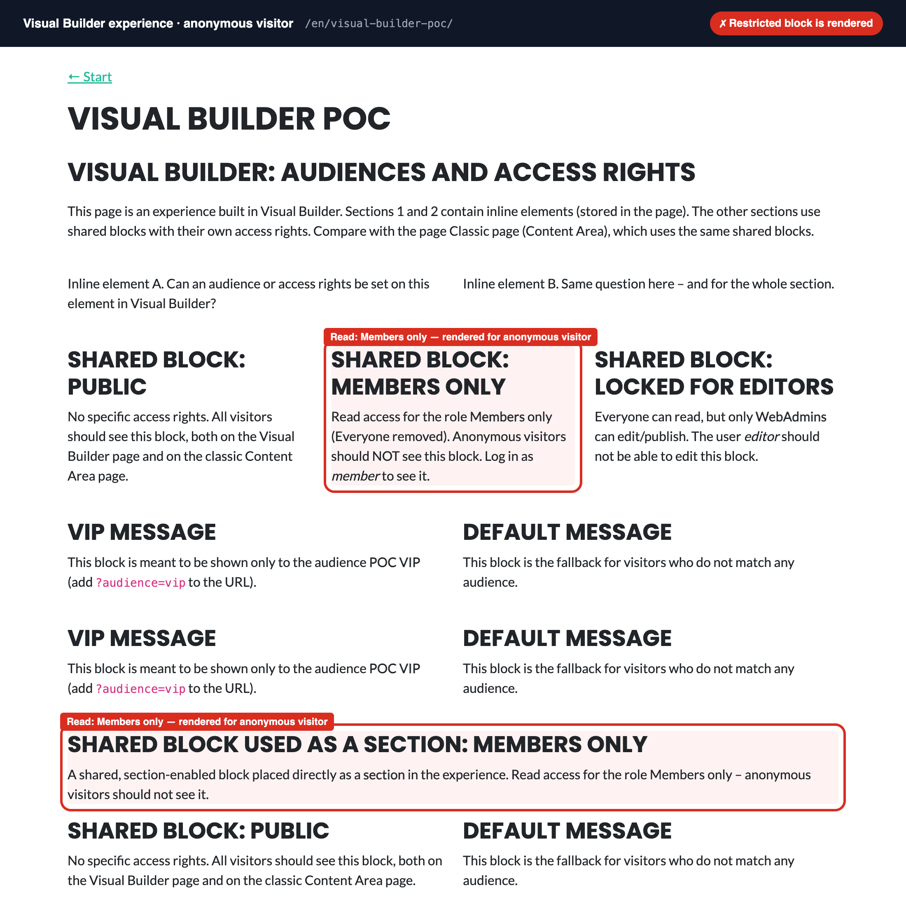
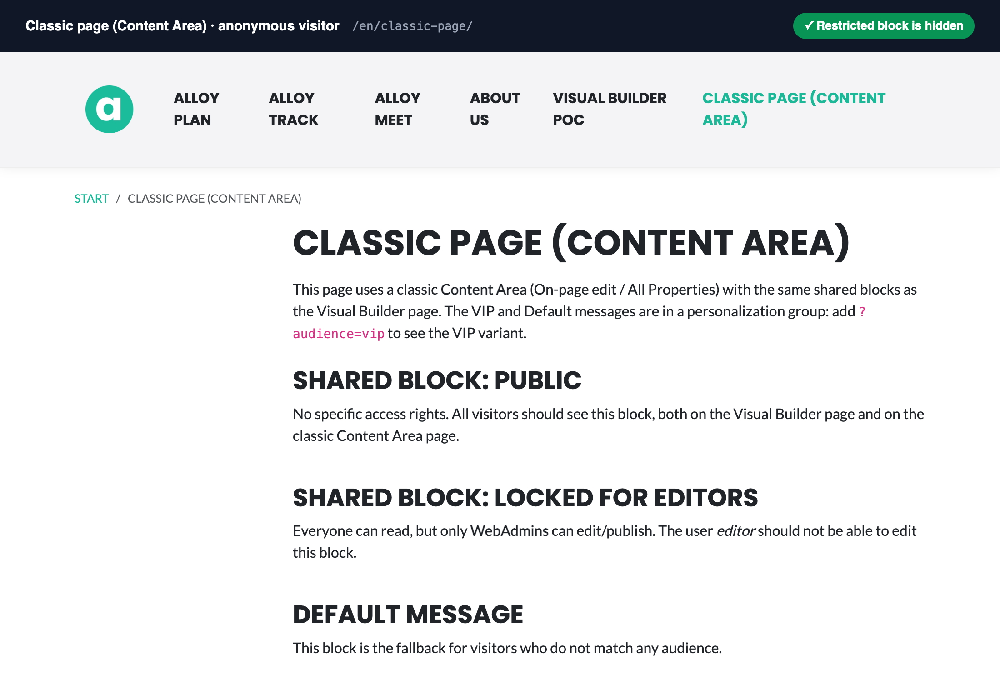
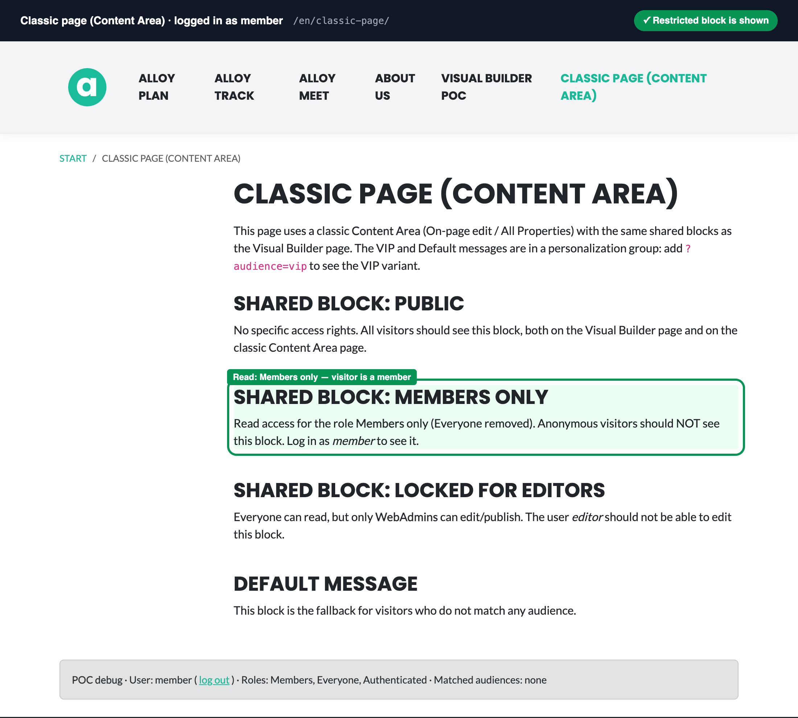

# Optimizely CMS 13: access rights on shared blocks are not enforced in Visual Builder

A minimal, runnable reproduction for Optimizely CMS 13.6.0 (PaaS, MVC, .NET 10, Alloy template).

**The problem:** a shared block with restricted read access is rendered to anonymous visitors when it is placed
in a Visual Builder experience. The same block is correctly hidden when it is placed in a classic Content Area.
Audiences (visitor groups) on shared blocks behave the same way: honoured in a Content Area, ignored in an experience.

Reported to Optimizely as support ticket #1963299.

## What it looks like

The shared block "Members only" has Read access for the role `Members` only (`Everyone` removed).
All three screenshots show the same published block.

**1. Visual Builder experience, anonymous visitor: the restricted block is rendered** (both as an element in a
column and as a section).



**2. Classic page with a Content Area, anonymous visitor: the restricted block is hidden.**



**3. Classic page, logged in as `member`: the restricted block is shown.** The access rights themselves work.



The red and green frames and the dark title bar were added to the screenshots; the pages are otherwise unmodified.

## Run it

Requirements: .NET 10 SDK and Docker.

```bash
docker compose up -d      # SQL Server 2022 on localhost:14333
./db/restore.sh           # restores db/Cms13Poc.bak into the container
dotnet run                # http://localhost:5080 and https://localhost:5443
```

`db/restore.sh` is a POSIX shell script (use Git Bash or WSL on Windows). Without Docker, restore
`db/Cms13Poc.bak` into any SQL Server 2022 instance as `Cms13Poc` and change the connection string in
`appsettings.Development.json`. Media files are included in `App_Data/blobs`.

| | |
|---|---|
| Visual Builder page | http://localhost:5080/en/visual-builder-poc/ |
| Classic page | http://localhost:5080/en/classic-page/ |
| CMS | http://localhost:5080/optimizely/cms |
| Log in / out | `/util/login`, `/util/logout` |

A grey **POC debug** bar at the bottom of each page shows the current user, roles and matched audiences.

### Accounts

Local test accounts only. All passwords and secrets in this repository are throwaway values for this POC.

| User | Password | Roles | Purpose |
|---|---|---|---|
| `admin` | `Admin123!poc` | WebAdmins | Everything, including access rights and audiences |
| `editor` | `Test123!poc` | WebEditors, VisitorGroupAdmins | Editor in Visual Builder |
| `member` | `Test123!poc` | Members | Visitor with Read access to the restricted blocks |

Audiences: **POC VIP** (matches `?audience=vip`) and **POC Student** (matches `?audience=student`).

## Reproduce in two minutes

Logged out:

1. Open `/en/visual-builder-poc/`. "Shared block: Members only" is visible. It should not be.
2. Open `/en/classic-page/`. The same block is hidden. Log in as `member` and it appears.
3. Open `/en/classic-page/?audience=vip`. "VIP message" replaces "Default message".
   On the Visual Builder page both are always shown.

Or from a terminal:

```bash
curl -s http://localhost:5080/en/visual-builder-poc/ | grep -c "Shared block: Members only"   # 1 (expected 0)
curl -s http://localhost:5080/en/classic-page/       | grep -c "Shared block: Members only"   # 0
```

## Content

Shared blocks (Shared Blocks > For All Applications). The same blocks are used on both pages.

| Block | Access rights |
|---|---|
| POC Shared block – Public | Inherited (everyone can read) |
| POC Shared block – Members only (read ACL) | Restricted, see below |
| POC Shared block as section – Members only (read ACL) | Restricted, see below |
| POC Shared block – Only admins can edit (edit ACL) | Everyone: Read. WebEditors: Read. WebAdmins, CmsAdmins: full access |
| POC Shared block – VIP message / Default message | Inherited, used for the audience test |

Exact access rights on the two restricted blocks (inheritance turned off, `Everyone` has no entry):

| Role | Access |
|---|---|
| Members | Read |
| WebEditors | Read, Create, Change, Delete, Publish |
| WebAdmins | Full access |
| CmsAdmins | Full access |

**Visual Builder POC** (experience, `/en/visual-builder-poc/`):

| Section | Content |
|---|---|
| 1–2 | Inline elements |
| 3 | Shared blocks with access rights, placed as elements in columns |
| 4 | VIP and Default shared blocks, no audience set |
| 5 | VIP and Default shared blocks with an audience written directly to the data (not possible in the UI) |
| 6 | A shared block placed directly as a section, restricted to Members |
| 7 | Hybrid workaround: a section that contains a classic Content Area with the same shared blocks |

**Classic page (Content Area)** (`/en/classic-page/`): the same shared blocks in `MainContentArea`.
VIP and Default are in a personalization group.

## Results (verified on 13.6.0)

| Question | Visual Builder | Classic Content Area |
|---|---|---|
| Set an audience on a section or element in the editor | No. The menu only has Rename, Save as Blueprint, Style, Remove | Yes. The block menu in the Content Area has Personalize |
| Set access rights on a section or inline element | No. They are not content items of their own; only the page's access rights apply | n/a |
| Set access rights on a shared block | Yes, in the block's own view: Options > Access Rights | Yes, same |
| Read access on a shared block is enforced for visitors | **No.** The Members block is rendered for anonymous visitors | Yes |
| Audience on a shared block is enforced | **No.** Both variants are rendered, even when the audience is set in the data | Yes |

Rendered output per visitor:

| Visitor | Sections 3–6 (directly in Visual Builder) | Section 7 (hybrid Content Area) |
|---|---|---|
| Anonymous | Members blocks and both VIP and Default are rendered | Public + Default |
| Anonymous, `?audience=vip` | same | Public + VIP |
| `member` | same | Public + Members + Default |
| `member`, `?audience=vip` | same | Public + Members + VIP |

## Why it happens

The experience is rendered with the documented tag helpers from `EPiServer.CMS.AspNetCore.TagHelpers` 13.6.0
(`Views/Experience/Index.cshtml`):

```cshtml
<epi-outline experience="@Model">
    <epi-grid class="vb-section my-4">
        <epi-row class="row">
            <epi-column class="col">
                <epi-component class="mb-3" />
            </epi-column>
        </epi-row>
    </epi-grid>
    <epi-component class="mb-3" />
</epi-outline>
```

From reading the decompiled 13.6.0 assemblies:

- `<epi-outline>` builds the composition through `ICompositionMapper.ToComposition`. Its only filter is
  `filterForPublished`. Shared blocks are loaded with `IContentLoader.Get`, which does not check access rights.
- `ComponentNodeRenderer` renders each component without an access check.
- The composition is cached per content item, not per visitor.
- A Content Area is rendered by the content area renderer, which applies `IContentAreaItemsRenderingFilter`
  (access rights and audiences). The Visual Builder path has no equivalent step.

There is no option to switch filtering on in the Visual Builder rendering path.

## Workarounds in this repository

### 1. Hybrid: a Content Area inside Visual Builder (section 7)

`ContentAreaSection` (`Models/Blocks/VisualBuilderElements.cs`) is a section-enabled block with a `ContentArea`
property. The editor adds the section to the experience and edits the Content Area in the Visual Builder side
panel, where each block has the usual menu with **Personalize**. Access rights and audiences are enforced,
because rendering goes through the Content Area pipeline.

Limitations:

- It has to be a **section**, not an element. The site fails to start if a type with `ElementEnabled` has a
  `ContentArea` property ("The property 'Items' is not allowed when content type has ElementEnabled").
  The hybrid block therefore cannot be placed in a column next to other elements.
- The view uses `@Html.PropertyFor`. The `epi-property` tag helper produced empty output here (cause not investigated).

### 2. A custom access filter in the Visual Builder rendering (`?vbfilter=1`)

`Business/Rendering/AccessFilteringNodeRenderer.cs` is a custom `ICompositionNodeRenderer` that sorts before the
built-in renderers and skips shared blocks the visitor is not allowed to read. It is only active with
`?vbfilter=1`, so the original behaviour stays available for comparison:

- `/en/visual-builder-poc/` logged out: the Members blocks are rendered in sections 3 and 6.
- `/en/visual-builder-poc/?vbfilter=1` logged out: they are not rendered. Logged in as `member`: they are.

Limitations: the interface is in an `*.Internal` namespace (unsupported API that can change between versions),
and it covers read access only, not audiences.

## On-page edit

On-page edit is off by default in CMS 13 (the view selector only has All Properties and Visual Builder).
It is switched on in `appsettings.json`:

```json
"EPiServer": { "CmsUI": { "CmsFeature": { "SectionsVisibility": { "OnPageEditing": true } } } }
```

- Classic pages then get **On-Page Editing** in the view selector, with the Content Area editor and Personalize.
- Experiences do **not**: `ExperiencePageUIDescriptor` explicitly disables the `onpageedit` view for `ExperienceData`.
- The Visual Builder view is also shown for classic pages (properties on the left, preview on the right). It can be
  limited to experiences with `EPiServer:CmsUI:VisualBuilder:ShowVisualBuilderForAllContentTypes = false` (not tested).

## Other findings

- Audiences are opt-in in CMS 13: the package `EPiServer.CMS.UI.VisitorGroups` plus
  `AddVisitorGroupsMvc().AddVisitorGroupsUI()`.
- No experience or section types are included; `BlankExperience` and `BlankSection` are defined in
  `Models/Pages/VisualBuilderTypes.cs`.
- A grid section cannot be saved as a shared block ("can only be used within experiences or as a blueprint").
  A shared block used as a section has to be a regular block type with `SectionEnabled`.
- `<epi-outline>` throws a NullReferenceException for an experience without a layout (guarded in
  `Views/Experience/Index.cshtml`).
- The CMS MCP server (`Optimizely.Cms.Opal.Tools` 13.4, `http://localhost:5080/mcp`, see `.mcp.json`):
  - has no tools for access rights, users or audiences,
  - stores a `reference` component in a composition as an inline **copy**, not as a shared reference,
  - fails on XhtmlString in such copies ("The XhtmlString instance is read-only"),
  - requires `properties` and `composition` as JSON strings,
  - runs as the role `CmsAdmins`, which needs access rights in the content tree.

Not tested: Optimizely Graph / headless delivery, expired or unpublished shared blocks in the Visual Builder
path, and versions other than 13.6.0.

## Where things are

- `Startup.cs` – tag helpers, audiences, MCP server, registration of the access filter.
- `Controllers/ExperienceController.cs`, `Views/Experience/Index.cshtml` – rendering of experiences.
- `Models/Blocks/VisualBuilderElements.cs` – elements and the hybrid section `ContentAreaSection`.
- `Business/PocSeeder.cs` – runs at startup and is idempotent: accounts, roles, audiences, access rights and the
  shared block references in the experience.
- `scripts/` – how the content was first created through the MCP server. Not needed when the database is restored.
- `db/` – database backup and restore script.
